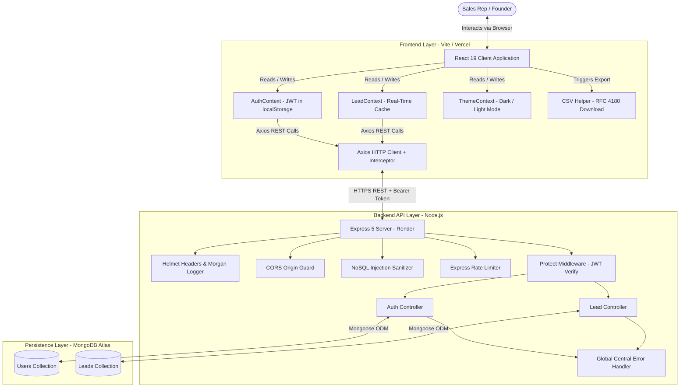
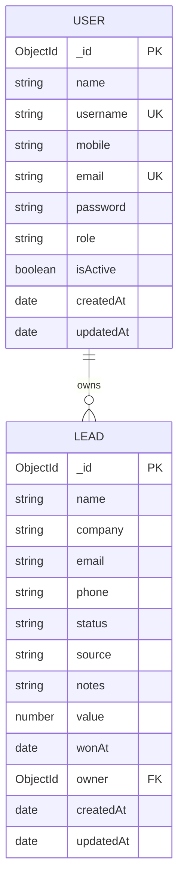
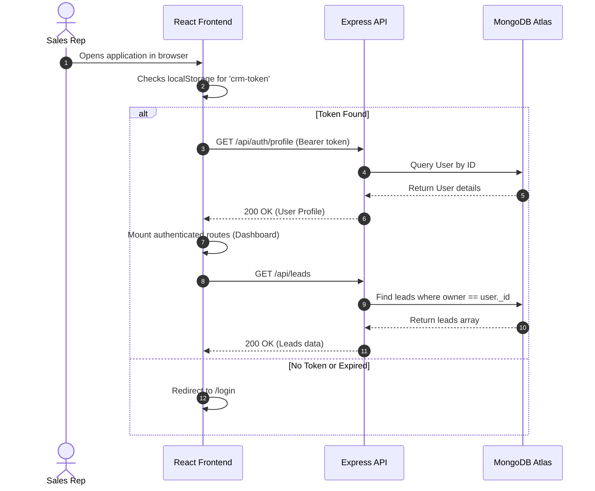
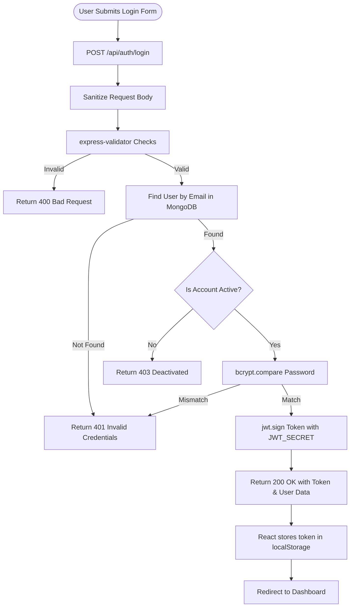
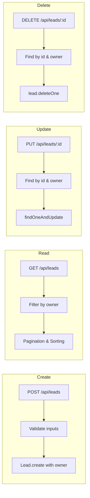
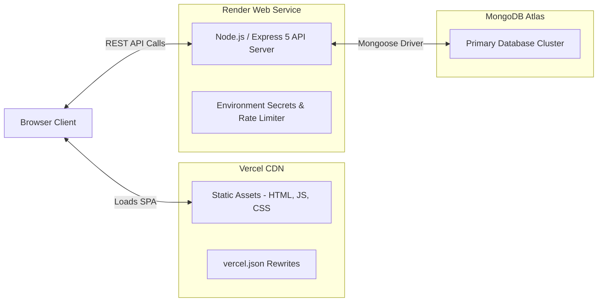

# Startup CRM Lite

<div align="center">
  
  <h3>Production-Grade Lightweight CRM & Pipeline Analytics for High-Velocity Startups</h3>
  <p><em>Engineered with React 19, Vite, Express 5, Node.js, and MongoDB Atlas.</em></p>

  [](#9-technology-stack)
  [](#10-frontend-technologies)
  [](#56-license-information)
  [](#10-frontend-technologies)
  [](#54-project-development-status)
</div>

---

## Table of Contents

1. [Project Title](#1-project-title)
2. [Project Overview](#2-project-overview)
3. [Project Description](#3-project-description)
4. [Problem Statement](#4-problem-statement)
5. [Proposed Solution](#5-proposed-solution)
6. [Project Objectives](#6-project-objectives)
7. [Key Features](#7-key-features)
8. [Feature Implementation Status](#8-feature-implementation-status)
9. [Technology Stack](#9-technology-stack)
10. [Frontend Technologies](#10-frontend-technologies)
11. [Backend Technologies](#11-backend-technologies)
12. [Database Technologies](#12-database-technologies)
13. [External Integrations](#13-external-integrations)
14. [System Requirements](#14-system-requirements)
15. [Project Architecture](#15-project-architecture)
16. [Architecture Diagram](#16-architecture-diagram)
17. [Project Directory Structure](#17-project-directory-structure)
18. [Frontend Structure](#18-frontend-structure)
19. [Backend Structure](#19-backend-structure)
20. [Database Structure](#20-database-structure)
21. [Database Schema](#21-database-schema)
22. [Data Models](#22-data-models)
23. [Application Workflow](#23-application-workflow)
24. [User Workflow](#24-user-workflow)
25. [Authentication Workflow](#25-authentication-workflow)
26. [Registration Process](#26-registration-process)
27. [Login Process](#27-login-process)
28. [Authorization and Security](#28-authorization-and-security)
29. [API Architecture](#29-api-architecture)
30. [API Endpoints](#30-api-endpoints)
31. [HTTP Methods and Responses](#31-http-methods-and-responses)
32. [CRUD Operations](#32-crud-operations)
33. [Dashboard Functionality](#33-dashboard-functionality)
34. [Lead Management](#34-lead-management)
35. [Search and Filtering](#35-search-and-filtering)
36. [Error Handling](#36-error-handling)
37. [Installation Prerequisites](#37-installation-prerequisites)
38. [Project Cloning Instructions](#38-project-cloning-instructions)
39. [Dependency Installation](#39-dependency-installation)
40. [Environment Configuration](#40-environment-configuration)
41. [Environment Variables Reference](#41-environment-variables-reference)
42. [Local Development Setup](#42-local-development-setup)
43. [Frontend Execution](#43-frontend-execution)
44. [Backend Execution](#44-backend-execution)
45. [Production Build](#45-production-build)
46. [Deployment Architecture](#46-deployment-architecture)
47. [Deployment Instructions](#47-deployment-instructions)
48. [Database Configuration](#48-database-configuration)
49. [Security Considerations](#49-security-considerations)
50. [Testing Information](#50-testing-information)
51. [Known Limitations](#51-known-limitations)
52. [Troubleshooting](#52-troubleshooting)
53. [Future Enhancements](#53-future-enhancements)
54. [Project Development Status](#54-project-development-status)
55. [Contribution Guidelines](#55-contribution-guidelines)
56. [License Information](#56-license-information)
57. [Contact and Acknowledgements](#57-contact-and-acknowledgements)

---

## 1. Project Title

**Startup CRM Lite** (Internal Package Identifier: `startup-crm-lite`)

---

## 2. Project Overview

**Startup CRM Lite** is a full-stack, responsive, and secure customer relationship management (CRM) application tailored specifically for high-velocity startup teams, business founders, and sales representatives. It balances zero-friction deal tracking with deep pipeline analytics without the enterprise complexity, bloat, or licensing costs of tools such as Salesforce or HubSpot.

---

## 3. Project Description

The system provides a unified Single Page Application (SPA) frontend communicating over a RESTful API with an Express 5 backend and a MongoDB database. Key functionalities include authenticated user management, complete lead lifecycle tracking across configurable pipeline stages (`New`, `Contacted`, `Meeting Scheduled`, `Proposal Sent`, `Won`, `Lost`), real-time deal valuation, interactive performance visualizations via Recharts, RFC 4180-compliant CSV exports, and granular user-scoped access control.

---

## 4. Problem Statement

Early-stage startups require a structured mechanism to track outbound prospects, follow-up dates, and conversion rates. However, they frequently suffer from two extremes:
1. **Spreadsheet Chaos:** Defaulting to Google Sheets or Excel leads to concurrent update conflicts, lack of role scoping, no automated deal-stage tracking, missing velocity metrics, and human input error.
2. **Enterprise Software Bloat:** Traditional CRM platforms demand lengthy implementation cycles, steep learning curves, mandatory credit card subscriptions, and unnecessary complexity.

---

## 5. Proposed Solution

Startup CRM Lite delivers a lightweight, modern web architecture that can be deployed to production in minutes:
- **Instant Usability:** Clean, intuitive UI with responsive mobile and desktop viewports.
- **Strict Data Ownership:** Every lead is indexed and linked to the authenticated user's ID, preventing data leakage across team members.
- **Real-Time Pipeline Intelligence:** Built-in calculation of deal values, win/loss rates, sales cycles, and monthly growth trends.
- **Enterprise-Grade Security Foundations:** JWT sessions, bcrypt password hashing (10 salt rounds), custom MongoDB injection guards, Helmet security headers, and IP rate limiting.

---

## 6. Project Objectives

- Provide an intuitive CRM interface with both responsive table and grid card layout modes.
- Implement robust token-based authentication with session auto-restoration and 401 interceptor redirection.
- Deliver comprehensive sales analytics including funnel progression, revenue trends, acquisition channels, and activity heatmaps.
- Maintain a decoupled client-server architecture ready for cloud deployment on Vercel and Render.
- Enforce strict input validation, defensive error handling, and MongoDB query sanitization.

---

## 7. Key Features

- **JWT Authentication & Profile System:** Secure signup, login, profile inspection, password change, and automatic session restoration.
- **Lead Lifecycle Management:** Create, view, edit, status-patch, and delete leads with deal values, contact details, acquisition source, and notes.
- **Pipeline Stage Tracking:** Explicit progression through `New`, `Contacted`, `Meeting Scheduled`, `Proposal Sent`, `Won`, and `Lost` with automatic `wonAt` timestamp capture.
- **Interactive Analytics Suite:** Dynamic charts using Recharts for pipeline distribution, monthly trends, conversion rates, revenue generation, marketing source breakdown, activity heatmaps, forecast revenue, and sales velocity.
- **Real-Time Search & Filtering:** Debounced search bar (300ms) indexing name, company, and email, alongside dynamic status pills displaying live lead counts.
- **Dual View Layout:** Seamless toggle between tabular view (desktop optimized) and responsive card grid (mobile and tablet optimized).
- **RFC 4180 CSV Data Export:** One-click client-side export generating clean CSV files formatted with UTF-8 BOM encoding for Excel compatibility.
- **Theme Engine:** Integrated light and dark mode toggling persisted in `localStorage` under `startup_crm_theme` and applied via CSS root variables and Tailwind dark variants.

---

## 8. Feature Implementation Status

The following matrix documents the verified status of features derived directly from codebase inspection:

| Feature Area | Specific Capability | Implementation Status | Verification Details |
|---|---|---|---|
| **Authentication** | User Registration (`/api/auth/register`) | **IMPLEMENTED** | Express validator, bcrypt hash hook, JWT returned |
| **Authentication** | User Login (`/api/auth/login`) | **IMPLEMENTED** | Password comparison, JWT issuance, 401 handling |
| **Authentication** | Session Restoration (`/api/auth/profile`) | **IMPLEMENTED** | `AuthContext` runs profile check on mount using token |
| **Authentication** | Profile Update (`/api/auth/profile`) | **IMPLEMENTED** | Updates display name and verifies old password for changes |
| **Authentication** | Email Password Reset Link | **PLANNED** | No mailing service (SMTP/SES) integrated in backend |
| **Lead Tracking** | Create Lead (`POST /api/leads`) | **IMPLEMENTED** | Validated, owner-scoped, deal value sanitized |
| **Lead Tracking** | List Leads (`GET /api/leads`) | **IMPLEMENTED** | Supports search, status, source, date, pagination, sorting |
| **Lead Tracking** | Update Lead (`PUT /api/leads/:id`) | **IMPLEMENTED** | Full edit, owner field modification explicitly blocked |
| **Lead Tracking** | Quick Status Update (`PATCH /api/leads/:id/status`) | **IMPLEMENTED** | Status validation, sets `wonAt` if marked 'Won' |
| **Lead Tracking** | Delete Lead (`DELETE /api/leads/:id`) | **IMPLEMENTED** | Owner-scoped deletion with confirm dialog |
| **Dashboard** | KPI Cards & Month-over-Month Stats | **IMPLEMENTED** | Computes active opportunities, pipeline revenue, avg conversion |
| **Dashboard** | Segmented Pipeline Progress Bar | **IMPLEMENTED** | Visual ratio representation across funnel stages |
| **Dashboard** | Recent Leads Table | **IMPLEMENTED** | Chronologically slices top 5 newest leads |
| **Analytics** | Date Range Filter (7d, 30d, 90d, Year, All) | **IMPLEMENTED** | `useAnalytics` hook computes metrics and growth |
| **Analytics** | Status Pie & Funnel Charts | **IMPLEMENTED** | Recharts `PieChart` and custom funnel layout |
| **Analytics** | Monthly Leads & Revenue Trends | **IMPLEMENTED** | Aggregated by month key over last 6 months |
| **Analytics** | Acquisition Source Chart | **IMPLEMENTED** | Breakdown across Website, LinkedIn, Referral, etc. |
| **Analytics** | Activity Heatmap | **IMPLEMENTED** | 5-tier intensity grid visualizer |
| **Data Transfer**| CSV Export (`exportLeadsToCSV`) | **IMPLEMENTED** | RFC 4180 escaping, UTF-8 BOM, browser download |
| **Data Transfer**| CSV File Import / Bulk Ingestion | **PLANNED** | No CSV parser or upload route exists in codebase |
| **UI / UX** | Dark Mode Toggle & Persistence | **IMPLEMENTED** | `ThemeContext` updates `<html>` class and `localStorage` |
| **UI / UX** | View Mode Toggle (Table / Card) | **IMPLEMENTED** | State toggles between `LeadTable` and `LeadCard` grid |
| **Multi-Tenancy**| Organization & Team Role Hierarchy | **PLANNED** | Schema contains `role` (`admin`/`user`), scoped to owner |

---

## 9. Technology Stack

```mermaid
block-beta
  columns 3
  block:frontend["Frontend Client"]:1
    react["React 19.2"]
    vite["Vite 8.0"]
    tailwind["Tailwind CSS 4.3"]
    router["React Router 7.17"]
    recharts["Recharts 3.8"]
  end
  block:backend["Backend API Server"]:1
    node["Node.js >=18"]
    express["Express 5.2"]
    jwt["JSON Web Token 9.0"]
    bcrypt["Bcryptjs 3.0"]
    validator["Express Validator 7.3"]
  end
  block:database["Database Layer"]:1
    mongo["MongoDB Atlas"]
    mongoose["Mongoose 9.7"]
    indexes["Compound Indexes"]
    aggregation["$facet Aggregation"]
  end
```



---

## 10. Frontend Technologies

- **Core Library:** [React 19.2.6](https://react.dev/) (Functional components, hooks, Context API).
- **Build Tool & Dev Server:** [Vite 8.0.12](https://vite.dev/) with `@vitejs/plugin-react` (6.0.1).
- **Styling Framework:** [Tailwind CSS v4.3.0](https://tailwindcss.com/) with `@tailwindcss/vite` compiler.
- **Design Tokens:** Custom Desert Clay theme defined via CSS custom variables (`--primary: #8A5A44`, `--secondary: #B07D62`, `--surface: #F2E8DF`, etc.) in `src/index.css`.
- **Routing:** [React Router DOM 7.17.0](https://reactrouter.com/) (`BrowserRouter`, `Routes`, `Route`, `Navigate`, `Outlet`).
- **Icons:** [Lucide React 1.18.0](https://lucide.dev/) (Feather icon set).
- **Visualizations:** [Recharts 3.8.1](https://recharts.org/) (ResponsiveContainer, PieChart, BarChart, LineChart).
- **HTTP Client:** [Axios 1.18.1](https://axios-http.com/) configured with request and response interceptors.
- **Feedback Alerts:** [React Hot Toast 2.6.0](https://react-hot-toast.com/) for non-blocking toast notifications.

---

## 11. Backend Technologies

- **Runtime:** [Node.js](https://nodejs.org/) (`>=18.0.0`, ECMAScript Modules `"type": "module"`).
- **Web Application Framework:** [Express 5.2.1](https://expressjs.com/) (next-generation Express runtime).
- **Authentication & Tokens:** [jsonwebtoken 9.0.3](https://github.com/auth0/node-jsonwebtoken) (HS256 signature).
- **Password Encryption:** [bcryptjs 3.0.3](https://github.com/dcodeIO/bcrypt.js) (salted one-way hashing).
- **Request Validation:** [express-validator 7.3.2](https://express-validator.github.io/) (declarative validation chains).
- **Security Middlewares:**
  - [helmet 8.2.0](https://helmetjs.github.io/) (OWASP-recommended security headers).
  - [express-rate-limit 8.5.2](https://github.com/express-rate-limit/express-rate-limit) (brute-force rate limiter).
  - Custom MongoDB query sanitizer against NoSQL operator injection.
  - [cors 2.8.6](https://github.com/expressjs/cors) (dynamic origin whitelist verification).
- **HTTP Logger:** [morgan 1.11.0](https://github.com/expressjs/morgan) (dev & combined modes).
- **Environment Management:** [dotenv 17.4.2](https://github.com/motdotla/dotenv).

---

## 12. Database Technologies

- **Database System:** [MongoDB Atlas](https://www.mongodb.com/atlas) (Cloud Document Database) / MongoDB Community Server.
- **Object Data Modeling (ODM):** [Mongoose 9.7.3](https://mongoosejs.com/).
- **Native MongoDB Driver:** `mongodb 7.4.0`.
- **Query Optimization:** Compound indexing on `{ owner: 1, status: 1 }`, `{ owner: 1, createdAt: -1 }`, and `{ owner: 1, source: 1 }`.
- **Pipeline Aggregations:** MongoDB `$facet` framework for computing pipeline stage counts, acquisition channels, and month-over-month trends in a single round-trip.

---

## 13. External Integrations

| Service / Provider | Category | Status | Verified Functionality |
|---|---|---|---|
| **MongoDB Atlas** | Managed Database | **Fully Implemented** | Connection via Mongoose with auto-reconnect and 5s timeout |
| **Vercel** | Frontend Hosting / CDN | **Fully Implemented** | Single-page rewrites configured via `vercel.json` |
| **Render** | Backend Hosting | **Fully Implemented** | Automated blueprint deployments configured via `render.yaml` |
| **Local MongoDB** | Database Fallback | **Fully Implemented** | Fallback to `mongodb://127.0.0.1:27017/startup-crm-lite` if Atlas is unreachable |
| **SMTP / Email** | Notification / Reset | **Not Configured** | No mailing service connected in current codebase |
| **Third-Party OAuth**| Social Sign-In | **Not Configured** | Only local email/password registration implemented |

---

## 14. System Requirements

- **Node.js:** Version `18.0.0` or higher (`node -v`).
- **NPM:** Version `9.0.0` or higher (`npm -v`).
- **Operating System:** Windows 10/11, macOS 12+, or Ubuntu 20.04+ LTS.
- **Database:** Local MongoDB instance running on port `27017` or access to a MongoDB Atlas cluster URI.
- **Memory & Storage:** 2 GB RAM minimum (4 GB recommended), 500 MB free disk space.

---

## 15. Project Architecture

The application adopts a decoupled Single Page Application (SPA) and REST API architecture. All state transitions, client routing, and rendering occur in the browser, while the backend functions as a stateless data gateway enforcing authentication, schema validation, and database operations.

---

## 16. Architecture Diagram



---

## 17. Project Directory Structure

```
startup-crm-lite/
├── .env                          # Frontend environment configuration
├── .gitignore                    # Git file exclusions
├── add-dark-mode.cjs             # Utility script for dark mode class injection
├── eslint.config.js              # ESLint configuration for frontend
├── index.html                    # Single Page Application HTML entry point
├── package.json                  # Root project scripts and dependencies
├── package-lock.json             # Root dependency lockfile
├── README.md                     # Comprehensive technical documentation
├── render.yaml                   # Render.com blueprint configuration
├── vercel.json                   # Vercel SPA URL rewrite rules
├── vite.config.js                # Vite build and plugin configurations
├── public/                       # Static public assets
│   ├── favicon.svg               # Application browser icon
│   └── icons.svg                 # SVG sprite definitions
├── src/                          # Active React 19 Frontend Source
│   ├── App.jsx                   # Root application container & toast setup
│   ├── index.css                 # Theme tokens, font imports, and Tailwind v4 setup
│   ├── main.jsx                  # React DOM bootstrap & provider tree
│   ├── assets/                   # Static images and brand logos
│   ├── components/               # Reusable UI component modules
│   │   ├── analytics/            # 14 analytics charts, widgets, and filters
│   │   ├── common/               # Sidebar, SearchBar, FilterBar, ThemeToggle, EmptyState
│   │   ├── dashboard/            # StatsCard, PipelineOverview, RecentLeads, QuickActions
│   │   └── leads/                # LeadTable, LeadCard, LeadForm, StatusBadge
│   ├── constants/                # Color palettes and status color mappings
│   ├── context/                  # AuthContext, LeadContext, ThemeContext
│   ├── hooks/                    # useAnalytics, useLocalStorage (empty placeholder)
│   ├── pages/                    # Dashboard, Leads, Analytics, Login, Register, NotFound
│   ├── routes/                   # Centralized router definition & ProtectedRoute
│   ├── services/                 # Axios client, authService, leadService
│   └── utils/                    # analyticsHelpers, csvHelpers
└── backend/                      # Node.js / Express 5 API Server
    ├── .env                      # Backend private environment configuration
    ├── .gitignore                # Backend git file exclusions
    ├── package.json              # Backend dependencies and scripts
    ├── package-lock.json         # Backend dependency lockfile
    ├── README.md                 # Minimal template README
    ├── server.js                 # Express server bootstrap, middlewares, shutdown hooks
    ├── vercel.json               # Backend rewrite config
    ├── vite.config.js            # Unused config in backend directory
    ├── config/                   # Database configuration
    │   └── database.js           # Mongoose connection with Atlas and local fallback
    ├── controllers/              # Request handling and business logic
    │   ├── authController.js     # User registration, login, profile operations
    │   └── leadController.js     # Lead CRUD operations and $facet aggregation stats
    ├── middleware/               # Express request pipeline filters
    │   ├── auth.js               # JWT extraction, verification, and user resolution
    │   ├── errorHandler.js       # Centralized error formatter (CastError, 11000, 503)
    │   └── validate.js           # express-validator result formatter
    ├── models/                   # Mongoose schema definitions
    │   ├── Lead.js               # Lead schema, virtuals, and compound indexes
    │   └── User.js               # User schema, bcrypt pre-save hook, comparePassword
    ├── routes/                   # Endpoint definitions
    │   ├── authRoutes.js         # Routes for registration, login, and profiles
    │   └── leadRoutes.js         # Routes for lead CRUD, stats, search, and status
    ├── utils/                    # Helper utilities
    │   └── apiResponse.js        # Standard success, error, and paginated responses
    └── src/                      # Duplicate/Legacy frontend copy (unused by backend)
```

---

## 18. Frontend Structure

The frontend application code is organized inside `/src`:
- **`src/main.jsx`**: Bootstraps the application via `createRoot` and wraps the app with `BrowserRouter`, `AuthProvider`, `LeadProvider`, and `ThemeProvider`.
- **`src/App.jsx`**: Renders the global `Toaster` notifications overlay and mounts `AppRoutes`.
- **`src/routes/index.jsx`**: Configures route definitions with lazy chunk loading (`React.lazy` and `Suspense`), manages `ProtectedRoute` redirects, and renders the `MainLayout` shell with collapsible sidebar and mobile drawer.
- **`src/context/`**:
  - `AuthContext.jsx`: Restores user session from `localStorage.getItem('crm-token')` on mount and exposes `login`, `register`, `logout`.
  - `LeadContext.jsx`: Handles lead state, pagination state, and wraps `leadService` calls. Automatically triggers `fetchLeads()` on valid token detection.
  - `ThemeContext.jsx`: Reads and writes `startup_crm_theme` in `localStorage`, adding or removing the `dark` class from `document.documentElement`.
- **`src/services/`**:
  - `api.js`: Base Axios instance with request and response interceptors.
  - `authService.js`: API methods for login, registration, and profile fetching.
  - `leadService.js`: API methods for lead CRUD, statistics, and monthly summaries.

---

## 19. Backend Structure

The backend application is organized inside `/backend`:
- **`server.js`**: Application entry point. Registers security middlewares, initializes CORS with dynamic origin whitelisting, mounts route trees, starts listening on `PORT`, and asynchronously connects to MongoDB.
- **`config/database.js`**: Connects via Mongoose to `MONGODB_URI` with a 5000 ms timeout. Automatically attempts a connection to a local fallback (`mongodb://127.0.0.1:27017/startup-crm-lite`) if the remote cluster fails.
- **`models/`**: Holds Mongoose schema files (`User.js` and `Lead.js`) incorporating field constraints, validation regexes, pre-save hooks, and indexes.
- **`controllers/`**: Encapsulates business logic. `authController.js` handles token generation and authentication, while `leadController.js` handles owner-scoped CRUD and aggregations.
- **`middleware/`**:
  - `auth.js`: Extracts `Bearer` token from `Authorization` header, verifies JWT, checks `isActive`, and attaches `req.user`.
  - `validate.js`: Checks `validationResult(req)` and formats 400 Bad Request responses.
  - `errorHandler.js`: Intercepts system exceptions, normalizing Mongoose `ValidationError` (400), `CastError` (404), duplicate key error `11000` (409), and database timeouts (503).
- **`utils/apiResponse.js`**: Ensures consistent API responses across all routes using `successResponse`, `errorResponse`, and `paginatedResponse`.

---

## 20. Database Structure

The database consists of two primary MongoDB collections: `users` and `leads`. All relationships are managed through document references where each `Lead` document holds an `owner` field storing the `ObjectId` of its corresponding `User`.



---

## 21. Database Schema

### Users Collection Schema (`backend/models/User.js`)
- Primary storage for authenticated user profiles and access credentials.
- Automatic password hashing via bcrypt pre-save hook.
- Password stripped from all JSON responses via `userSchema.methods.toJSON`.

### Leads Collection Schema (`backend/models/Lead.js`)
- Primary storage for sales opportunities.
- Strict pipeline status constraints: `['New', 'Contacted', 'Meeting Scheduled', 'Proposal Sent', 'Won', 'Lost']`.
- Strict acquisition source constraints: `['Website', 'Referral', 'LinkedIn', 'Cold Call', 'Email Campaign', 'Other']`.
- Deal valuation tracking with non-negative constraints (`min: 0`).
- Virtual field `age` computing days elapsed since creation.

---

## 22. Data Models

### User Model Attributes
| Attribute | Type | Constraints | Description |
|---|---|---|---|
| `_id` | `ObjectId` | Auto-generated PK | Unique user record identifier |
| `name` | `String` | Required, trim, length 2–50 | Full display name |
| `username` | `String` | Required, unique, sparse, min 3 | Unique account handle |
| `mobile` | `String` | Required, trim | User phone / contact number |
| `email` | `String` | Required, unique, lowercase, regex | Login identifier |
| `password` | `String` | Required, min 6, hashed | Bcrypt hashed password (10 rounds) |
| `role` | `String` | Enum: `['admin', 'user']`, default: `'user'` | Access control role |
| `isActive` | `Boolean` | Default: `true` | Account active flag |
| `createdAt` | `Date` | Timestamp | Account creation timestamp |
| `updatedAt` | `Date` | Timestamp | Profile last updated timestamp |

### Lead Model Attributes
| Attribute | Type | Constraints | Description |
|---|---|---|---|
| `_id` | `ObjectId` | Auto-generated PK | Unique lead record identifier |
| `name` | `String` | Required, trim, length 2–100 | Contact person's full name |
| `company` | `String` | Required, trim | Target company or client organization |
| `email` | `String` | Required, trim, valid email regex | Professional email address |
| `phone` | `String` | Optional, trim | Phone / mobile number |
| `status` | `String` | Enum: 6 stages, default: `'New'` | Current sales pipeline stage |
| `source` | `String` | Enum: 6 channels, default: `'Website'` | Marketing / acquisition channel |
| `notes` | `String` | Optional, max 1000 chars | Free-text notes and interaction log |
| `value` | `Number` | Min: 0, default: `0` | Estimated deal value in USD |
| `wonAt` | `Date` | Optional | Timestamp when status changed to 'Won' |
| `owner` | `ObjectId` | Required, ref: `'User'` | Foreign key reference to owning User |
| `age` *(Virtual)* | `Number` | Read-only | Number of days since lead creation |
| `createdAt` | `Date` | Timestamp | Record creation timestamp |
| `updatedAt` | `Date` | Timestamp | Record last updated timestamp |

---

## 23. Application Workflow



---

## 24. User Workflow

1. **Authentication:** The user registers a new administrator account or logs in with existing credentials.
2. **Dashboard Overview:** Upon login, the user lands on the Dashboard view displaying live pipeline revenue, total lead counts, conversion rates, and quick action shortcuts.
3. **Lead Creation:** Clicking **Add New Lead** opens a modal form with client-side validation. Submitting creates the record in MongoDB and adds it to the active UI state.
4. **Pipeline Progression:** Users filter or search through leads and update stages directly via modal edits or the status badge.
5. **Analytics Review:** Users navigate to the Analytics tab to inspect conversion funnels, monthly deal acquisition, source attribution, and activity heatmaps.
6. **Data Export:** Users export their filtered lead list to CSV format with a single click.
7. **Sign Out:** Users trigger logout from the profile popover, purging the token and redirecting to the login screen.

---

## 25. Authentication Workflow

Authentication is completely stateless using JSON Web Tokens (JWT).



---

## 26. Registration Process

1. User submits `name`, `email`, `password`, and `confirmPassword` on `/register`.
2. Client validates that password is at least 6 characters and confirms passwords match.
3. `authService.register` sends `POST /api/auth/register`, deriving a username and fallback mobile number.
4. Express middleware validates inputs via `registerValidation`.
5. Controller checks for existing `email` or `username` conflicts (returns 409 Conflict if found).
6. Mongoose `pre('save')` hook hashes the password with 10 salt rounds.
7. User document is persisted with default role `'admin'`.
8. JWT is generated and returned with HTTP 201 Created.
9. Frontend stores `crm-token` in `localStorage` and redirects to `/`.

---

## 27. Login Process

1. User enters `email` and `password` on `/login`.
2. Form submits `POST /api/auth/login`.
3. Backend looks up user document explicitly including `+password`.
4. Instance method `user.comparePassword(candidatePassword)` runs `bcrypt.compare`.
5. If invalid, returns HTTP 401 with `'Invalid credentials'`.
6. If user account has `isActive === false`, returns HTTP 403 `'Account is deactivated'`.
7. Signs JWT access token with `JWT_SECRET` and expiration (`JWT_EXPIRES_IN` or default `7d`).
8. Returns HTTP 200 with `{ token, user }` (password stripped via `toJSON`).
9. Axios interceptor attaches token to all subsequent outbound requests.

---

## 28. Authorization and Security

- **Route Protection:** All endpoints under `/api/leads` and `/api/auth/profile` require the `protect` middleware.
- **Data Isolation:** Every lead query explicitly enforces `{ owner: req.user._id }`. Users cannot read, modify, or delete leads belonging to other users.
- **Owner Immutable:** Controller explicitly strips `owner` from update payloads (`delete updateData.owner`) to prevent ownership hijacking.
- **XSS & Injection Protection:** Helmet secures HTTP response headers; custom query sanitization strips `$` and `.` operators.
- **Rate Limiting:** IP rate limiting restricts abuse to 100 requests per 15-minute window for both general and auth endpoints.

---

## 29. API Architecture

The backend implements standard RESTful principles:
- **Base URL:** `/api`
- **Payload Format:** JSON (`application/json`)
- **Authentication Scheme:** HTTP `Authorization: Bearer <token>`
- **Response Structure:**
  ```json
  {
    "success": true,
    "message": "Descriptive message",
    "data": {}
  }
  ```

---

## 30. API Endpoints

### Authentication Endpoints (`/api/auth`)
| Method | Endpoint | Access | Request Body | Description |
|---|---|---|---|---|
| `POST` | `/api/auth/register` | Public | `{ name, email, password, username, mobile }` | Registers user & returns JWT |
| `POST` | `/api/auth/login` | Public | `{ email, password }` | Authenticates credentials & returns JWT |
| `GET` | `/api/auth/profile` | Protected | None | Returns active user profile |
| `PUT` | `/api/auth/profile` | Protected | `{ name, oldPassword, newPassword }` | Updates profile name or password |
| `GET` | `/api/auth/me` | Protected | None | Alias for `/profile` |

### Leads Endpoints (`/api/leads`)
| Method | Endpoint | Access | Query Parameters | Description |
|---|---|---|---|---|
| `GET` | `/api/leads` | Protected | `status, search, source, dateFrom, dateTo, page, limit, sortBy, sortOrder` | Returns paginated leads list |
| `POST` | `/api/leads` | Protected | None (Body: lead details) | Creates a new lead |
| `GET` | `/api/leads/stats` | Protected | None | Aggregated pipeline KPI metrics |
| `GET` | `/api/leads/stats/summary` | Protected | None | Alias for `/stats` |
| `GET` | `/api/leads/monthly-stats` | Protected | None | 6-month monthly registration trends |
| `GET` | `/api/leads/stats/monthly` | Protected | None | Alias for `/monthly-stats` |
| `GET` | `/api/leads/search` | Protected | `q, limit` | Autocomplete lead search (max 20) |
| `GET` | `/api/leads/:id` | Protected | None | Retrieves single lead details by ID |
| `PUT` | `/api/leads/:id` | Protected | None (Body: updated fields) | Updates lead details |
| `PATCH`| `/api/leads/:id/status` | Protected | None (Body: `{ status }`) | Updates lead status stage |
| `DELETE`| `/api/leads/:id` | Protected | None | Deletes lead record |

### Utility Endpoints
| Method | Endpoint | Access | Description |
|---|---|---|---|
| `GET` | `/api/health` | Public | Health check returning status and current server timestamp |

---

## 31. HTTP Methods and Responses

Standard status codes used across all controllers:
- `200 OK`: Request succeeded; data returned.
- `201 Created`: Resource successfully created (lead or user).
- `400 Bad Request`: Input validation failed or invalid enum value.
- `401 Unauthorized`: Missing, expired, or invalid token; invalid credentials.
- `403 Forbidden`: User account deactivated.
- `404 Not Found`: Target lead or route does not exist.
- `409 Conflict`: Duplicate key conflict (email or username already exists).
- `500 Internal Server Error`: Unhandled application exception.
- `503 Service Unavailable`: Database timeout or cluster connection unreachable.

---

## 32. CRUD Operations



---

## 33. Dashboard Functionality

The Dashboard view (`src/pages/Dashboard.jsx`) computes and renders:
1. **Total Leads Card:** Total count with month-over-month growth percentage.
2. **Active Opportunities Card:** Leads in `New`, `Contacted`, `Meeting Scheduled`, and `Proposal Sent` stages.
3. **Pipeline Revenue Card:** Sum of deal values for all active opportunities.
4. **Avg Conversion Time Card:** Average days elapsed from creation to 'Won' status.
5. **Quick Actions Panel:** One-click shortcuts for adding a lead, navigating to all leads, and downloading CSV data.
6. **Recent Leads Table:** Top 5 latest leads sorted chronologically.
7. **Pipeline Overview Bar:** Segmented colored progress bar showing stage proportions.

---

## 34. Lead Management

The Lead Management view (`src/pages/Leads.jsx`) offers:
- **Responsive Layout Toggle:** Switch between full `LeadTable` view on desktop and `LeadCard` grid on mobile devices.
- **Lead Creation & Editing:** Modal form (`LeadForm.jsx`) supporting name, company, email, phone, deal value, status, and marketing source.
- **Interactive Deletion:** Deletion with confirmation window and feedback toasts.
- **Context Integration:** Direct binding to `LeadContext` ensures instantaneous state updates across the UI without full page reloads.

---

## 35. Search and Filtering

- **Debounced Search:** `SearchBar.jsx` buffers user input with a 300 ms debounce before triggering search filters across name, company, and email fields.
- **Dynamic Status Filter Bar:** `FilterBar.jsx` displays clickable filter pills (`All`, `New`, `Contacted`, `Meeting Scheduled`, `Proposal Sent`, `Won`, `Lost`) with live counts.
- **Empty States:** `EmptyState.jsx` provides customized messaging when no records match filter criteria and includes a "Clear Search & Filters" button.

---

## 36. Error Handling

- **Client-Side:** Axios interceptor catches 401 errors, clears expired tokens from `localStorage`, and safely redirects to `/login`. Network errors display non-blocking error toasts.
- **Backend Validation:** `express-validator` returns structured field-by-field error breakdowns (`{ field, message }`).
- **Global Error Middleware:** `errorHandler.js` normalizes Mongoose validation errors, cast errors, MongoDB duplicate keys (code 11000), and JWT expiration into uniform JSON responses.
- **Database Fallback:** If MongoDB Atlas fails, the server logs a warning and attempts connecting to a local MongoDB instance on `127.0.0.1:27017`.

---

## 37. Installation Prerequisites

Ensure the following tools are installed:
- [Node.js](https://nodejs.org/) `>= 18.0.0`
- [Git](https://git-scm.com/)
- [MongoDB](https://www.mongodb.com/try/download/community) (optional, if running a local database)

Verify installations:
```bash
node -v
npm -v
git --version
```

---

## 38. Project Cloning Instructions

Clone the repository to your local workstation:
```bash
git clone https://github.com/charithasree13/startup-crm-lite.git
cd startup-crm-lite
```

---

## 39. Dependency Installation

The project contains two separate `package.json` manifests (root and backend). Install both:

```bash
# 1. Install root frontend dependencies
npm install

# 2. Install backend API dependencies
npm run build:backend
```

*(Alternatively: `cd backend && npm install && cd ..`)*

---

## 40. Environment Configuration

The application requires environment files in two locations:

1. **Root Directory (`.env`):** Defines the frontend API connection URL.
2. **Backend Directory (`backend/.env`):** Defines the database credentials, port, and JWT secret.

---

## 41. Environment Variables Reference

### Frontend Configuration (`/.env`)
| Variable | Required | Default Value | Description |
|---|---|---|---|
| `VITE_API_URL` | Optional | `http://localhost:5000` | Target backend REST API URL |

### Backend Configuration (`/backend/.env`)
| Variable | Required | Default / Recommended Value | Description |
|---|---|---|---|
| `PORT` | Optional | `5000` | Port for Express server |
| `NODE_ENV` | Optional | `development` | Environment mode (`development` / `production`) |
| `MONGODB_URI` | **Required** | `mongodb://127.0.0.1:27017/startup-crm-lite` | MongoDB Atlas or local connection string |
| `JWT_SECRET` | **Required** | Random 32+ char string | Secret key for signing JWT tokens |
| `JWT_EXPIRES_IN`| Optional | `7d` | Token expiration period |
| `FRONTEND_URL` | Optional | `http://localhost:5173` | Allowed frontend origin for CORS |

---

## 42. Local Development Setup

To run both the frontend and backend servers concurrently:

```bash
npm run dev:full
```

This uses `concurrently` to execute:
- Frontend on `http://localhost:5173`
- Backend API on `http://localhost:5000`

---

## 43. Frontend Execution

To run only the React development server:
```bash
npm run dev
```

Open `http://localhost:5173` in your browser.

---

## 44. Backend Execution

To run only the Express API server:
```bash
# Using nodemon for auto-reload
npm run dev --prefix backend

# Or using plain node
npm run start:backend
```

The API will be available at `http://localhost:5000`.

---

## 45. Production Build

To compile the frontend Single Page Application into optimized static assets:
```bash
npm run build
```

This compiles JavaScript, bundles CSS via `@tailwindcss/vite`, and outputs production artifacts to the `/dist` directory.

To preview the built production output locally:
```bash
npm run preview
```

---

## 46. Deployment Architecture



---

## 47. Deployment Instructions

### Deploying Frontend to Vercel
1. Push repository to GitHub.
2. Import project in [Vercel](https://vercel.com).
3. Set **Framework Preset** to `Vite`.
4. Set **Root Directory** to `./`.
5. Configure Build & Output Settings:
   - **Build Command:** `npm run build`
   - **Output Directory:** `dist`
6. Add Environment Variable:
   - `VITE_API_URL`: URL of your deployed Render backend (e.g. `https://your-api.onrender.com`).
7. Deploy. `vercel.json` will automatically handle SPA routing rewrites.

### Deploying Backend to Render
1. Create a new **Web Service** on [Render](https://render.com).
2. Connect your GitHub repository.
3. Configure Service Settings:
   - **Root Directory:** `backend`
   - **Environment:** `Node`
   - **Build Command:** `npm install`
   - **Start Command:** `npm start`
4. Add Environment Variables:
   - `NODE_ENV`: `production`
   - `PORT`: `10000`
   - `MONGODB_URI`: Your MongoDB Atlas connection URI.
   - `JWT_SECRET`: A secure random cryptographic secret string.
   - `FRONTEND_URL`: URL of your deployed Vercel frontend.
5. Deploy. Render reads `render.yaml` automatically if deploying via Blueprint.

---

## 48. Database Configuration

### Connecting to MongoDB Atlas
1. Create a free M0 cluster on [MongoDB Atlas](https://www.mongodb.com/atlas).
2. Create a database user with read/write credentials.
3. Under **Network Access**, add `0.0.0.0/0` (allow access from anywhere, required for Render).
4. Copy the connection URI:
   ```
   mongodb+srv://<username>:<password>@cluster0.mongodb.net/startup-crm-lite?retryWrites=true&w=majority
   ```
5. Place this string into `backend/.env` under `MONGODB_URI`.

---

## 49. Security Considerations

1. **NoSQL Injection Guard:** Custom middleware in `server.js` recursively strips keys starting with `$` or containing `.` from `req.body`, `req.query`, and `req.params`.
2. **Credential Sanitization:** User passwords are encrypted with bcrypt (10 rounds). The Mongoose model's `toJSON` method explicitly strips `password` from output objects.
3. **HTTP Header Hardening:** `helmet()` applies secure default headers (HSTS, Content-Security-Policy, X-Frame-Options, X-Content-Type-Options).
4. **DOS & Request Capping:** Payload size limit is locked to `10kb` (`express.json({ limit: '10kb' })`).
5. **Brute Force Limiting:** `express-rate-limit` throttles requests to 100 requests per 15 minutes per IP address.
6. **Cross-Origin Security:** CORS origin resolution strictly validates requests against whitelisted domains and dynamically permits valid `.vercel.app` deployments.

---

## 50. Testing Information

- **Linting:** Configured with ESLint 10. Run lint checks across the codebase:
  ```bash
  npm run lint
  ```
- **Automated Tests:** Not currently implemented in the codebase (`backend/package.json` script outputs `"No tests yet"`).
- **Manual Verification:** Verified working workflows:
  - User registration and login flow.
  - JWT token preservation across page reloads.
  - CRUD operations on leads with deal values and dates.
  - Recharts visual rendering across all 14 analytics cards.
  - RFC 4180 CSV export download in browser.

---

## 51. Known Limitations

- **Single User Scoping:** Leads are isolated to the creator's user account; multi-user team collaboration sharing a single workspace is not yet implemented.
- **No Email Transport:** Password reset via email is not configured (requires SMTP / AWS SES integration).
- **CSV Import Missing:** CSV export is implemented, but bulk CSV file import is not yet implemented.
- **Automated Test Coverage:** Automated integration and unit tests (Vitest / Jest / Supertest) are not yet configured.

---

## 52. Troubleshooting

#### 1. Cannot connect to MongoDB Atlas / 503 Error
- **Symptom:** API returns 503 Service Unavailable or logs `buffering timed out`.
- **Solution:** Verify your IP address is whitelisted in MongoDB Atlas Network Access (`0.0.0.0/0`). Ensure `MONGODB_URI` contains correct credentials and database name.

#### 2. CORS Error on Outbound Requests
- **Symptom:** Browser console logs `CORS header 'Access-Control-Allow-Origin' missing`.
- **Solution:** Ensure the frontend URL is listed in `allowedOrigins` in `backend/server.js` or passed as `FRONTEND_URL` in `backend/.env`.

#### 3. Automatic Redirect to `/login`
- **Symptom:** Opening protected pages immediately redirects to login.
- **Solution:** The token in `localStorage` has expired or is invalid. Log in again to receive a fresh token.

#### 4. Windows PowerShell Script Execution Error
- **Symptom:** `npm : File ... cannot be loaded because running scripts is disabled`.
- **Solution:** Run commands through `cmd /c npm ...` or enable script execution: `Set-ExecutionPolicy -Scope CurrentUser -ExecutionPolicy RemoteSigned`.

---

## 53. Future Enhancements

- [ ] **Automated Test Suite:** Add Vitest and React Testing Library for frontend, and Supertest for backend endpoints.
- [ ] **CSV File Ingestion:** Add bulk lead import from CSV files with column mapping.
- [ ] **Email Notifications:** Integrate SendGrid or AWS SES for password resets and lead assignment alerts.
- [ ] **Kanban Board:** Add drag-and-drop pipeline stage updates.
- [ ] **Multi-Tenant Team Workspaces:** Support shared organizations with role-based access control (Admin, Manager, Rep).

---

## 54. Project Development Status

- **Status:** Active / Production-Ready MVP (v1.0.0).
- **Core CRUD & Analytics:** 100% Functional.
- **Security & Database Isolation:** 100% Functional.
- **Deployment Blueprints:** Verified for Vercel and Render.

---

## 55. Contribution Guidelines

1. Fork the repository on GitHub.
2. Create a descriptive feature branch:
   ```bash
   git checkout -b feature/your-feature-name
   ```
3. Commit your changes with clear, structured commit messages:
   ```bash
   git commit -m "feat: add kanban board view for leads"
   ```
4. Push to your branch:
   ```bash
   git push origin feature/your-feature-name
   ```
5. Open a Pull Request against the `main` branch.

---

## 56. License Information

This project is licensed under the **MIT License**.

```
MIT License

Copyright (c) 2026 Startup CRM Lite Contributors

Permission is hereby granted, free of charge, to any person obtaining a copy
of this software and associated documentation files (the "Software"), to deal
in the Software without restriction, including without limitation the rights
to use, copy, modify, merge, publish, distribute, sublicense, and/or sell
copies of the Software, and to permit persons to whom the Software is
furnished to do so, subject to the following conditions:

The above copyright notice and this permission notice shall be included in all
copies or substantial portions of the Software.

THE SOFTWARE IS PROVIDED "AS IS", WITHOUT WARRANTY OF ANY KIND, EXPRESS OR
IMPLIED, INCLUDING BUT NOT LIMITED TO THE WARRANTIES OF MERCHANTABILITY,
FITNESS FOR A PARTICULAR PURPOSE AND NONINFRINGEMENT. IN NO EVENT SHALL THE
AUTHORS OR COPYRIGHT HOLDERS BE LIABLE FOR ANY CLAIM, DAMAGES OR OTHER
LIABILITY, WHETHER IN AN ACTION OF CONTRACT, TORT OR OTHERWISE, ARISING FROM,
OUT OF OR IN CONNECTION WITH THE SOFTWARE OR THE USE OR OTHER DEALINGS IN THE
SOFTWARE.
```

---

## 57. Contact and Acknowledgements

### Project Maintainer
- **Author:** Charithasree
- **GitHub:** [@charithasree13](https://github.com/charithasree13)
- **Repository:** [startup-crm-lite](https://github.com/charithasree13/startup-crm-lite)

### Acknowledgements
- [React](https://react.dev/) & [Vite](https://vite.dev/) teams for modern tooling.
- [Lucide Icons](https://lucide.dev/) for icon designs.
- [Tailwind CSS](https://tailwindcss.com/) for utility styling.
- [Recharts](https://recharts.org/) for charting components.
- [Mongoose](https://mongoosejs.com/) for MongoDB modeling.
